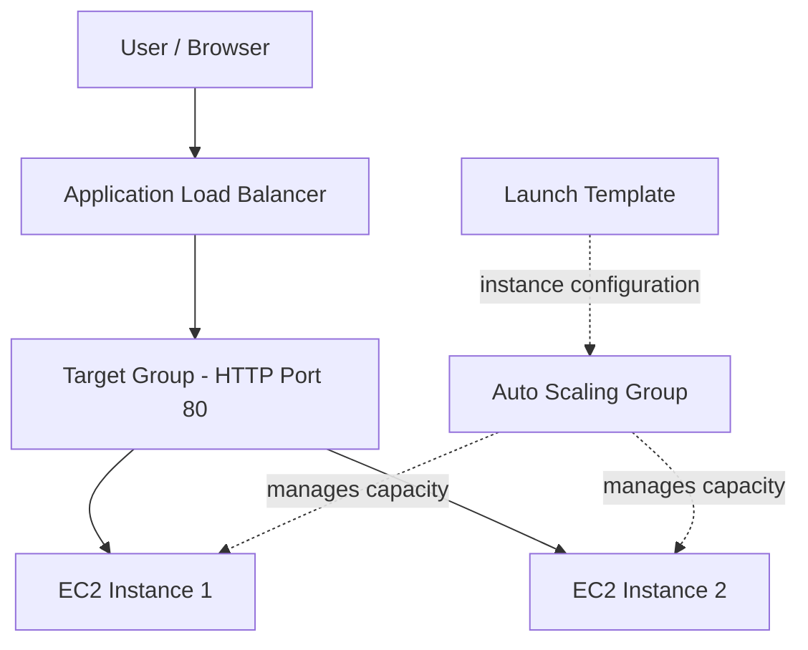
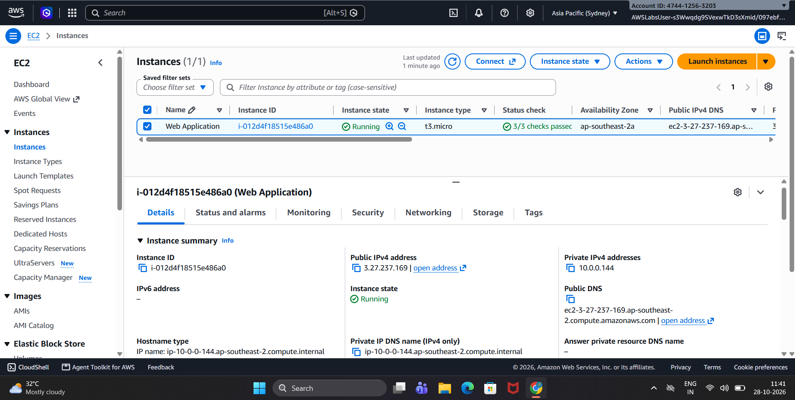
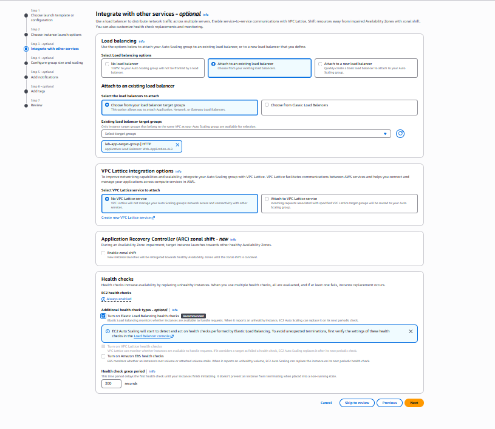
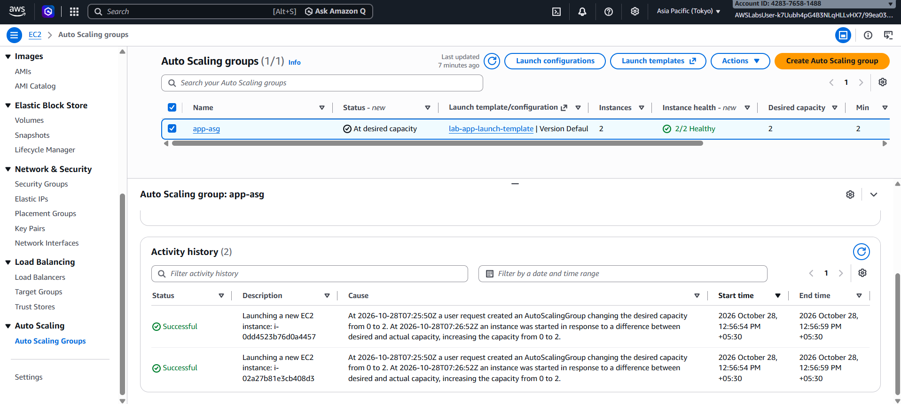
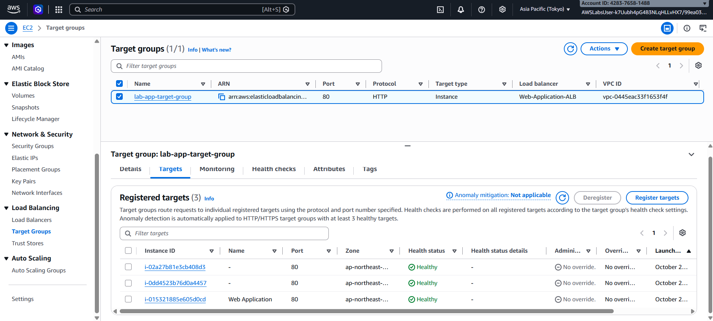

# aws-cloud-technical-essentials
Hands-on AWS cloud learning: EC2, Launch Templates, Auto Scaling, Application Load Balancer and Target group health checks.

## Overview
This repository documents my practical learning from AWS Cloud Technical Essentials. It covers core AWS infrastructure services and how they can work together to host and scale a web application.

## Objectives
- Understand AWS Identity and Access Management (IAM).
- Launch an EC2 instance for application hosting.
- Use a launch template for reusable instance configuration.
- Configure an EC2 Auto Scaling group.
- Integrate an Application Load Balancer (ALB) with a target group.
- Review target health checks and application availability.
- Learn where serverless computing fits into cloud architecture.

## Architecture

## AWS Services and Learning
| Service | Practical learning |
|---|---|
| IAM | Studied users, groups, roles and permissions. |
| Amazon EC2 | Launched an instance for a web application. |
| Launch Templates | Configured reusable EC2 launch settings. |
| Auto Scaling | Configured desired capacity 2, minimum 2 and maximum 4. |
| Application Load Balancer | Configured an HTTP listener to forward requests to a target group. |
| Target Groups | Verified that three registered targets reported Healthy in the captured screenshot. |
| Serverless | Studied serverless concepts and where they fit in application architecture. |

## Evidence Screenshots
Add screenshots to the `screenshots/` folder and use the following links:

### EC2 Instance

### Launch Template

### Auto Scaling Group

### Application Load Balancer

### Target Group Health

## Key Takeaways
- Understood how EC2 instances host applications.
- Learned how launch templates support repeatable instance creation.
- Practised configuring Auto Scaling capacity limits.
- Understood how an ALB routes HTTP traffic through a target group.
- Learned how target health checks help assess instance availability.

## Validation and Limitations
The screenshots document the configuration and status visible at the time of capture. Verify that the ALB is Active, the application responds through the ALB DNS name, and the target group and Auto Scaling group membership are consistent before claiming end-to-end validation. The screenshots show two instances in the Auto Scaling group and three registered target-group instances; this difference needs to be checked.

## Security Notes
- No AWS access keys, secret keys, passwords, session tokens or private credentials are included.
- Public screenshots should have account IDs and lab usernames redacted.
- This repository contains documentation and screenshots, not production credentials or deployment automation.

## Learning Source
AWS Cloud Technical Essentials

## Author
Santanu Ghosh
