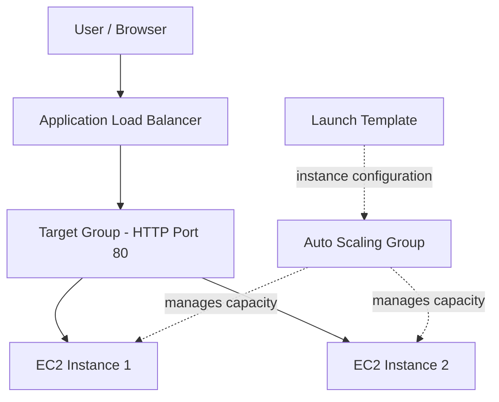
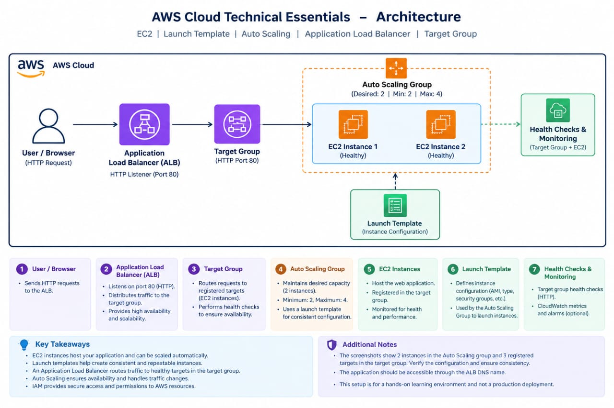
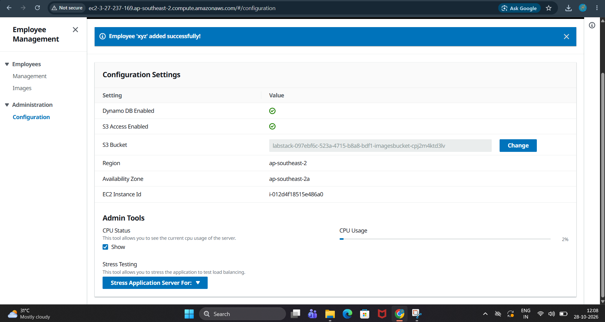

# aws-high-avaliability-3-tier-web-application
Hands-on AWS cloud learning: EC2, Launch Templates, Auto Scaling, Application Load Balancer, Target group health checks, Amazon DynamoDB, Amazon S3, AWS IAM and Amazon CloudWatch.

## Overview
This repository documents my practical learning from AWS Cloud Technical Essentials. It covers core AWS infrastructure services and how they can work together to host and scale a web application.

## The Configured Web Application Architecture Includes:
- Presentation Layer: Application Load Balancer(ALB).
- Application Layer: EC2 instances with Auto Scaling across two Availability Zones.
- Data Layer: Amazon DynamoDB.
- Storage: Amazon S3 for image storage.
- Security: AWS IAM.
- Monitoring: Amazon CloudWatch.
  
## Objectives
- Understand AWS Identity and Access Management (IAM).
- Launch an EC2 instance for application hosting.
- Use a launch template for reusable instance configuration.
- Configure an EC2 Auto Scaling group.
- Integrate an Application Load Balancer (ALB) with a target group.
- Review target health checks and application availability.
- Learn where serverless computing fits into cloud architecture.

## Architecture

## AWS Architecture Diagram

The following diagram illustrates the relationship between
the Application Load Balancer, Target Group, EC2 instances,
Auto Scaling Group, and Launch Template.

## Website Preview

The screenshot below shows the web application associated
with this hands-on learning project.

## AWS Services and Learning
| Service | Practical learning |
|---|---|
| IAM | Studied users, groups, roles and permissions. |
| Amazon EC2 | Launched an instance for a web application. |
| Launch Templates | Configured reusable EC2 launch settings. |
| Auto Scaling | Configured desired capacity 2, minimum 2 and maximum 4. |
| Application Load Balancer | Configured an HTTP listener to forward requests to a target group. |
| Target Groups | Verified that three registered targets reported Healthy in the captured screenshot. |
| Serverless | Studied serverless concepts and where they fit in application architecture. |

## Evidence Screenshots
Add screenshots to the `screenshots/` folder and use the following links:

### EC2 Instance

### Launch Template

### Auto Scaling Group

### Target Group Health

## EC2 User Data and Bash Scripting

Used EC2 User Data to explore automated instance initialization
with a Bash script.

[View EC2 User Data Bash Script](ec2-user-data.sh)

## This script performs the following tasks:

- Installs system updates
- Installs a source repository so the Node.js installer can be downloaded
- Installs Node.js
- Installs the EPEL repository that provides additional options for package installation
- Installs the stress package to stress the CPU
- Downloads the application code
- Creates a dedicated directory for the web application
- Downloads and deploys (extracts) the application into the specified directory
- Tells the application the bucket where the images are available
- Tells the application the Region where the application is running
- Installs the application dependencies
- Starts the web application

## Key Takeaways
- Understood how EC2 instances host applications.
- Learned how launch templates support repeatable instance creation.
- Practised configuring Auto Scaling capacity limits.
- Understood how an ALB routes HTTP traffic through a target group.
- Learned how target health checks help assess instance availability.

## Validation and Limitations
The screenshots document the configuration and status visible at the time of capture. Verify that the ALB is Active, the application responds through the ALB DNS name, and the target group and Auto Scaling group membership are consistent before claiming end-to-end validation. The screenshots show two instances in the Auto Scaling group and three registered target-group instances; this difference needs to be checked.

## Security Notes
- No AWS access keys, secret keys, passwords, session tokens or private credentials are included.
- Public screenshots should have account IDs and lab usernames redacted.
- This repository contains documentation and screenshots, not production credentials or deployment automation.

## Testing and Validation

The AWS setup was tested to verify the following:

- Application Load Balancer status: Active.
- Target Group health checks: Healthy.
- Application accessibility: Verified through the Load Balancer DNS name.
- EC2 instances: Managed through an Auto Scaling Group.
- Launch Template: Used to define EC2 instance configuration.

## Key Learnings

- Configured and explored EC2 instances.
- Learned how Launch Templates support consistent instance configuration.
- Explored Auto Scaling Group capacity settings.
- Understood how an Application Load Balancer distributes traffic through a Target Group.
- Verified target health and application access through the load balancer.

## Project Purpose

This repository documents hands-on learning from AWS Cloud Technical Essentials. It is an educational exercise and not a claim of a production-grade deployment.

## Learning Source
AWS Cloud Technical Essentials

## Author
Santanu Ghosh
